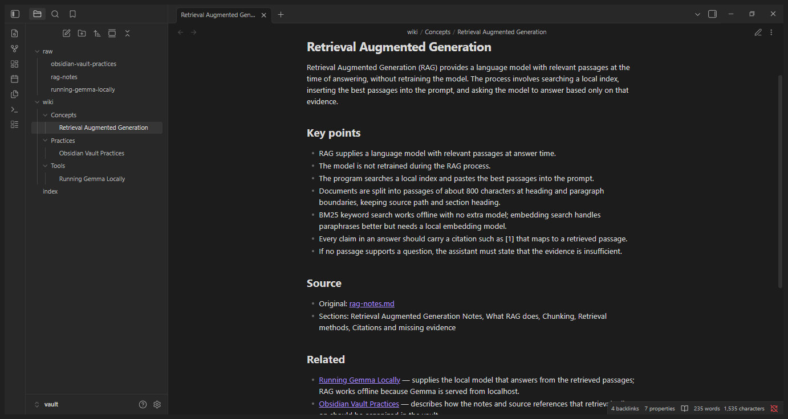
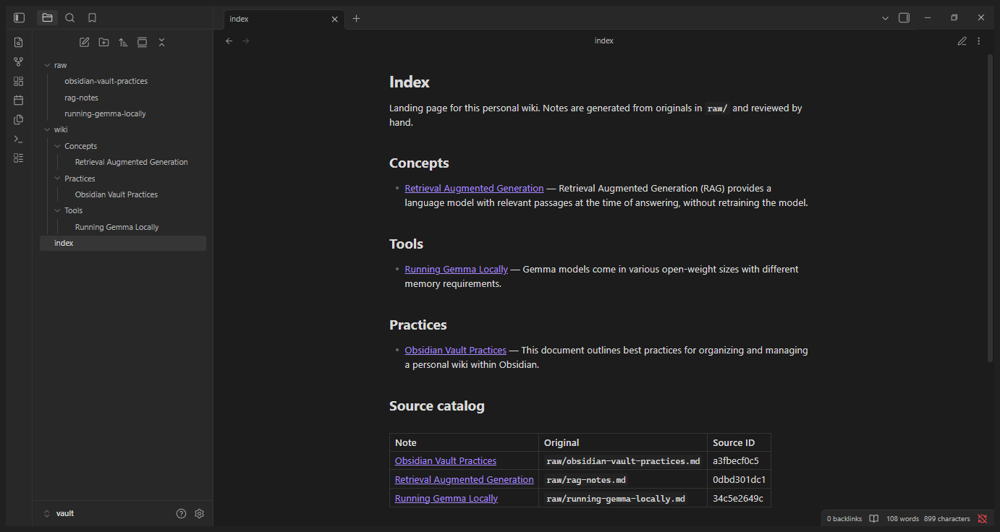
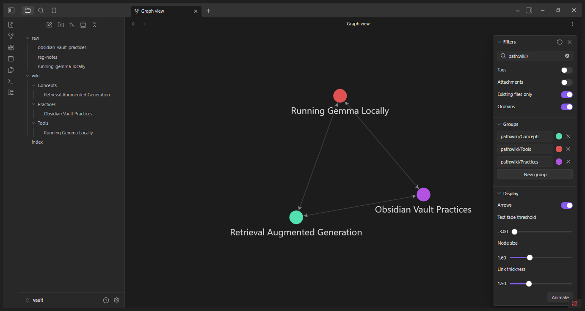
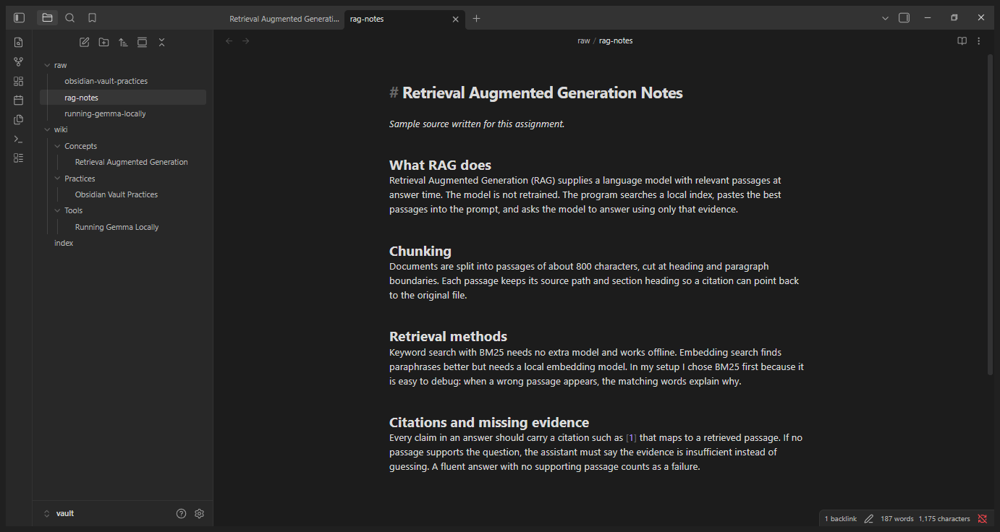

# Personal Wiki CLI with Local Gemma + RAG (Assignment 4)

A command-line personal wiki: my own harness around a local Gemma model (via Ollama) and my own BM25 retrieval.
Modes: `chat` (assistant), `ask` (grounded, cited answers), `search` (raw passages, no model), plus `ingest` and `--help`.

## Purpose and sources
The wiki answers questions about running Gemma locally, RAG basics, and Obsidian vault practice. The three sources in
[`vault/raw/`](vault/raw) are **short sample notes written for this assignment** (safe to publish); they are preserved unchanged:

| Original | Generated note |
|---|---|
| [rag-notes.md](vault/raw/rag-notes.md) | [Retrieval Augmented Generation](vault/wiki/Concepts/Retrieval%20Augmented%20Generation.md) |
| [running-gemma-locally.md](vault/raw/running-gemma-locally.md) | [Running Gemma Locally](vault/wiki/Tools/Running%20Gemma%20Locally.md) |
| [obsidian-vault-practices.md](vault/raw/obsidian-vault-practices.md) | [Obsidian Vault Practices](vault/wiki/Practices/Obsidian%20Vault%20Practices.md) |

Landing page: [vault/index.md](vault/index.md). Each note's front matter keeps `source`, `source_id` (sha1 of path) and
`original_filename`; the catalog `index_data/catalog.json` maps source_id -> page. Gemma drafts each page; I reviewed them
against the originals, fixed the Related section (the auto-generated "shared terms" reasons were junk) and added two
missing key points, then marked them `status: reviewed`.

## Setup and device
- OS: Windows 11 Home. CPU: AMD Ryzen 5 7520U (CPU-only, no dedicated VRAM, 0.5 GB shared). RAM: 15.2 GB total (about 1.6 GB free while the model was loaded plus other apps open). Free disk: 93.7 GB.
- Runtime: Ollama 0.34.3. Model: `gemma4:e2b`, 5.1B parameters (E2B effective size), **Q4_K_M** quantization, context 4096 used.
- Python 3.14, standard library only (optional `pypdf` for PDFs).

```bash
# while online, once
ollama pull gemma4:e2b
# run (from this folder)
python wiki.py --help
python wiki.py ingest
python wiki.py search "BM25 keyword search"
python wiki.py ask "How much memory does the E4B Gemma model need to load at Q4_0?"
python wiki.py chat
```
**Why E2B:** the machine has no GPU and 16 GB RAM; E2B is the smallest size and answered all tests correctly (I did not test E4B/26B; 26B would not fit and E4B would leave little memory for the OS). Measured: `ollama ps` shows 6.7 GB loaded, 100% CPU. Ingesting 3 sources took **124 s** in
total (37–47 s per source, includes ~20 s first model load); ask answers took **13–23 s**; chat replies 6–31 s. Re-ingest with no changes: 0.1 s.

## Architecture
- **Model:** Gemma via Ollama at `127.0.0.1:11434` ([llm.py](wikicli/llm.py)). It only sees what the harness puts in the prompt.
- **Retrieval tool:** [retrieval.py](wikicli/retrieval.py). Chunks the *original* files (about 800 chars, split at headings/paragraphs, keeping path + section), BM25 with light stemming. No model needed.
- **RAG workflow (ask):** question -> `search` top 3 passages -> prompt = [wiki-instructions.md](instructions/wiki-instructions.md) + numbered SOURCES + question -> Gemma (temperature 0) -> citation check -> evidence card.
- **Harness:** [harness.py](wikicli/harness.py) and [ingest.py](wikicli/ingest.py). Picks instructions per mode, holds chat history (last 6 turns), decides whether chat retrieves, verifies that each `[n]` citation maps to a retrieved passage, and saves evidence.
- **CLI:** [wiki.py](wiki.py) (argparse) shows mode/execution/model on every run and gives errors for a missing Ollama or model.

One traced path, `python wiki.py ask "..."`: `main()` -> `cmd_ask` -> `harness.ask` -> `retrieval.search` -> `format_sources` -> `llm.chat` -> `check_citations` -> `save_card` -> printed answer.

## Design choices
- Passages of about 800 chars, top 3 (about 2,400 chars) go to Gemma, well inside the 4096-token context. Ingest sends up to 6,000 chars per source.
- **Ask** is standalone: no history, no persona, temperature 0. **Chat** loads [persona.md](instructions/persona.md), keeps history, and retrieves only if the message is not a capability/greeting question and BM25 finds a passage matching at least half the query terms and at least 2 terms (or the user says "my notes"/"the wiki"). "make that shorter" therefore never triggers retrieval. Chat history stores only plain messages, never pasted notes. `/save` is an explicit action and writes to `memory/`, which is not indexed.
- **Naming:** 2–6 word subject titles, category folders `Concepts/ Tools/ Practices/`; filename = first heading. Machine IDs live in front matter. Same title from another source gets a qualifier (` - Name`), never a hash.
- **Re-ingestion:** unchanged sources (sha256) are skipped; changed sources update the same page from the catalog; reviewed pages with `%% related:curated %%` keep their links. Verified: second run created no new files.
- Test expectations ([tests/questions.md](tests/questions.md)) and machine files (`index_data/`, `evidence/`) are outside the vault.

## Evidence (all local, model `gemma4:e2b`)
| Test | Card | Result |
|---|---|---|
| 1 direct | [test1](evidence/ask/test1.md) | "about 4.5 GB [1]" correct, citation valid |
| 2 paraphrase | [test2](evidence/ask/test2.md) | correct (no discrete VRAM, CPU, E2B via Ollama [1]); a RAG passage also retrieved as noise |
| 3 two facts | [test3](evidence/ask/test3.md) | correct: `wiki/` filter + Attachments off [1]; 2–6 word names [2] |
| 4 unsupported | [test4](evidence/ask/test4-unsupported.md) | "INSUFFICIENT EVIDENCE: the sources do not state the cost per million tokens..." |
| 4 first attempt (failure) | [attempt 1](evidence/ask/test4-attempt1-malformed.md) | model printed only "INSUFFICIENT EVIDENCE:" twice; fixed by adding a full-sentence example to the instructions (example deliberately unrelated to the test) |

Mode checks: [chat transcript](evidence/modes/chat-check.txt) (capability question with no notes lookup, plan, "make that shorter" using the conversation), [search check](evidence/modes/search-check.txt) (passages only), [ask vs chat](evidence/modes/ask-vs-chat-check.txt) (a "cat name" stated only in chat was refused as insufficient evidence). Ingestion: [first run](evidence/ingest/ingest-first-run.txt), [re-ingest](evidence/ingest/ingest-reingest.txt).
In each card, the cited passages were opened and support the material claims. Retrieval was inspected before the answer: the right passage ranked first in all four tests.

The first set of cards above was produced online during development (Ollama still only used localhost).

### Offline demonstration
[`RUN-OFFLINE-DEMO.bat`](RUN-OFFLINE-DEMO.bat) runs [scripts/offline-demo.ps1](scripts/offline-demo.ps1). The script waits
until both a web request and a ping fail, restarts Ollama, then runs help, a real model ingestion (on a scratch copy so
reviewed pages are not overwritten), a re-ingest of the real vault, the four ask tests, search, chat and the ask-vs-chat
check, each as a fresh CLI process. Results: **[evidence/offline/SUMMARY.md](evidence/offline/SUMMARY.md)** (network
check, device, per-step output, timings, memory, transcript, screenshot).

### Obsidian (vault opened at `vault/`)
Graph filter used: `path:wiki/`, Attachments off, color groups by folder (saved in `vault/.obsidian/graph.json`).

| Open note with source + related links | Topic index and source catalog |
|---|---|
|  |  |
| **Graph view** | **Trace: note's "Original" link opens the raw source** |
|  |  |

Trace checked: `index` -> [[Retrieval Augmented Generation]] -> related [[Running Gemma Locally]] -> back, and
Original: `rag-notes.md` opens `raw/rag-notes.md`, whose sha256 still matches `source_sha256` in the note (unchanged).
Re-ingest leaves exactly 3 pages ([re-ingest output](evidence/ingest/ingest-reingest.txt)).

## Reflection
Limitation: keyword-only BM25 retrieves same-topic passages for unsupported questions (test 4 retrieved three Gemma passages), so the 2B model alone must decide "insufficient", and it failed once. Improvement: add a local embedding model plus a score threshold before generation, and a second-pass check that each sentence is entailed by its cited passage. A second, smaller issue: the first chat transcript shows `you> you>` because piped input was echoed twice (cosmetic; fixed in `wiki.py`). Chat's `[notes consulted]` line shows whether retrieval ran, not whether the reply is grounded.

Optional online mode is not implemented; local is the only mode. No model weights or credentials are committed.
